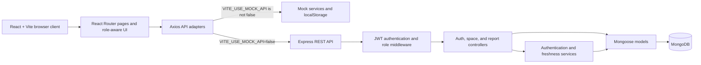

# StudySpot

**A community-powered campus study-space directory built with the MERN stack.**

StudySpot helps students find libraries, reading rooms, computer labs, and other campus study areas. Members can browse facilities, see the latest availability reports, and share their own updates. Moderators can create, edit, and deactivate study-space listings.

> **Availability is community-reported.** StudySpot does not provide live occupancy data, seat reservations, or sensor-based monitoring. Reports can become outdated.

## Project Overview

Students often have limited information about where to study, what facilities a space has, or whether another student recently found it busy. StudySpot provides a single directory with campus locations and community-submitted availability updates. It is a college project and demonstration application; it should not be treated as an authoritative occupancy service.

The React/Vite client can use either local mock services or the Express API. In live API mode, Express uses Mongoose to read and write MongoDB documents. The client must be explicitly configured for live API mode; its default is mock mode.

## Objectives

- Provide a searchable, filterable directory of study spaces.
- Display each space’s location, description, facilities, and suitability attributes.
- Let authenticated members submit one of the supported availability statuses.
- Preserve report history and show the newest report separately from its freshness.
- Provide role-restricted moderator tools for listing management.
- Validate API requests and return consistent JSON response envelopes.
- Support isolated frontend development and automated tests without requiring a live database.

## Key Features

### Student/member features

- Browse active spaces and view a space’s details.
- Search by space name, building, area, or description.
- Combine filters for building, area, availability status, facility, quiet-zone suitability, and group-study suitability.
- Read the latest community report and paginated report history.
- Submit an availability report with an optional note while authenticated.

### Moderator features

- Open a role-protected dashboard with space and report summary counts.
- Search listings and filter active/inactive spaces.
- Create, edit, and deactivate study-space listings.
- Retain report history when a listing is deactivated.
- Reset sample data only in the mock-data development mode; this control is not a live API reset operation.

### Authentication and authorization

- Register as a member and log in through the shared authentication pages.
- Passwords are hashed with bcryptjs before storage.
- The backend issues JWTs with a one-day expiry.
- Authenticated requests use a bearer token; the backend reloads the user from MongoDB and checks the current database role.
- Moderator invitations can be created by an existing moderator and used during registration. Invitations expire after 24 hours, are stored as hashes, and are one-time use.
- Frontend route protection improves navigation UX only. **All sensitive authorization must be enforced by the backend**, which protects moderator APIs independently of the React UI.

### Community availability reporting

Signed-in members and moderators may submit reports using these exact values:

- `Available`
- `Moderately Busy`
- `Busy`
- `Temporarily Closed`

Each submission creates a separate report linked to the study space and reporting user. The server assigns the reporter identity and report timestamp.

### Report history and freshness

- The latest report is selected by report timestamp (with a stable tie-breaker).
- History is returned newest first and supports pagination.
- The backend derives freshness from `STATUS_STALE_AFTER_MINUTES` (default: 60 minutes).
- Freshness is `Fresh`, `Stale`, or `No Report`; it is not an availability status and does not change the report’s original status.
- Live API responses include backend freshness metadata for consistent client display. Mock mode calculates freshness using the Vite-exposed setting.

## Non-goals and Limitations

- No live sensor-based occupancy or real-time seat counting.
- No seat reservations or booking workflow.
- Availability is community-reported and may be stale or inaccurate.
- No report approval, rejection, or resolution workflow is implemented.
- No separate moderation/audit log is implemented.
- Invitation email delivery, email-bound invitations, and an invitation-management dashboard are not implemented. Invitation links are shared manually.
- There is no public API to bootstrap the first moderator; an authorized moderator must already exist to create invitations.
- JWT refresh and server-side token revocation are not implemented.
- Mock authentication and browser storage are for development only and are not secure.

## Screenshots

No reviewed screenshot image files are currently included. See [`screenshots/README.md`](./screenshots/README.md) for the screenshot-folder note. This README intentionally does not embed placeholder or invented screenshots.

## Technology Stack

| Area | Technologies |
|---|---|
| Frontend | React 18, JavaScript, Vite, React Router DOM |
| UI | CSS, Lucide React |
| HTTP client | Axios |
| Backend | Node.js, Express 5 |
| Database and ODM | MongoDB, Mongoose |
| Authentication | bcryptjs, jsonwebtoken |
| Frontend testing | Vitest, jsdom, React Testing Library, jest-dom |
| Backend testing | Node.js test runner, Supertest, mongodb-memory-server |
| Deployment | No deployment provider or project configuration is verifiable from the repository. See [Deployment](#deployment). |

## High-Level Architecture



Mock services are an alternative client data path; they do not prove that the backend or MongoDB is available. The Express API is the server-side authorization boundary.

## Repository Structure

The following tree reflects the application source, tests, and project documentation in the reviewed checkout. Dependency folders and generated build output are omitted.

```text
studyspot/
├── README.md
├── .env.example                 # Legacy example; not loaded by current server startup
├── .gitignore
├── client/
│   ├── .env.example
│   ├── index.html
│   ├── package.json
│   ├── package-lock.json
│   ├── vite.config.js
│   ├── public/
│   │   └── .gitkeep
│   └── src/
│       ├── App.jsx
│       ├── main.jsx
│       ├── api/
│       │   ├── authApi.js
│       │   ├── axios.js
│       │   ├── reportsApi.js
│       │   └── spacesApi.js
│       ├── components/
│       │   ├── ConfirmDialog.jsx
│       │   ├── EmptyState.jsx
│       │   ├── ErrorState.jsx
│       │   ├── Footer.jsx
│       │   ├── FreshnessBadge.jsx
│       │   ├── LoadingState.jsx
│       │   ├── ModeratorRoute.jsx
│       │   ├── Navbar.jsx
│       │   ├── ProtectedRoute.jsx
│       │   ├── ReportForm.jsx
│       │   ├── ReportHistory.jsx
│       │   ├── SearchFilters.jsx
│       │   ├── SpaceCard.jsx
│       │   ├── StatusBadge.jsx
│       │   └── Toast.jsx
│       ├── context/
│       │   └── AuthContext.jsx
│       ├── data/
│       │   ├── mockReports.js
│       │   ├── mockSpaces.js
│       │   └── mockUsers.js
│       ├── layouts/
│       │   └── MainLayout.jsx
│       ├── pages/
│       │   ├── HomePage.jsx
│       │   ├── LoginPage.jsx
│       │   ├── ModeratorDashboard.jsx
│       │   ├── NotFoundPage.jsx
│       │   ├── RegisterPage.jsx
│       │   ├── SpaceDetailsPage.jsx
│       │   └── SpacesPage.jsx
│       ├── services/
│       │   ├── mockAuthService.js
│       │   ├── mockReportService.js
│       │   ├── mockSpaceService.js
│       │   └── mockStorage.js
│       ├── styles/
│       │   ├── components.css
│       │   └── globals.css
│       ├── test/
│       │   ├── forms-and-routes.test.jsx
│       │   ├── moderator-scroll.test.jsx
│       │   ├── moderator-space-edit.test.jsx
│       │   ├── services.test.js
│       │   ├── setup.js
│       │   ├── status-report-page.test.jsx
│       │   └── statusUtils.test.js
│       └── utils/
│           ├── dateUtils.js
│           ├── statusUtils.js
│           └── validation.js
├── server/
│   ├── .env.example
│   ├── .gitignore
│   ├── README.md
│   ├── app.js
│   ├── package.json
│   ├── package-lock.json
│   ├── server.js
│   ├── scripts/
│   │   └── seed.js
│   ├── src/
│   │   ├── config/db.js
│   │   ├── controllers/
│   │   │   ├── authController.js
│   │   │   ├── reportController.js
│   │   │   └── spaceController.js
│   │   ├── middleware/authMiddleware.js
│   │   ├── models/
│   │   │   ├── ModeratorInvitation.js
│   │   │   ├── SpaceReport.js
│   │   │   ├── StudySpace.js
│   │   │   └── User.js
│   │   ├── routes/
│   │   │   ├── authRoutes.js
│   │   │   ├── reportRoutes.js
│   │   │   └── spaceRoutes.js
│   │   ├── services/
│   │   │   ├── authService.js
│   │   │   ├── moderatorInvitationService.js
│   │   │   └── statusService.js
│   │   └── utils/reportConstants.js
│   └── tests/
│       ├── auth.test.js
│       ├── reports.test.js
│       ├── seed.test.js
│       └── spaces.test.js
├── docs/
│   ├── API.md
│   ├── QA-REPORT-2026-11-03.md
│   ├── TEAM_RESPONSIBILITIES.md
│   └── TESTING.md
└── screenshots/
    └── README.md
```

## Application Workflow

1. The server loads protected configuration, connects to MongoDB, and starts the Express listener.
2. The browser loads the React application and routes.
3. API adapters use mock services unless `VITE_USE_MOCK_API` is exactly `false`.
4. In live mode, Axios sends requests to `VITE_API_BASE_URL` and attaches a stored bearer token when present.
5. Registration creates a member unless a valid moderator invitation token is supplied.
6. Login verifies the account password and returns a JWT and public user data.
7. The backend reloads the current user from MongoDB for authenticated requests.
8. Public pages fetch active study spaces and their report data.
9. Authenticated members submit reports; the backend associates the report with the current user and timestamp.
10. Moderators use protected endpoints to create, edit, and deactivate spaces.

## Authentication and Authorization

- **Registration:** `POST /api/auth/register`; name, email, password, and matching `confirmPassword` are required. A public registration request cannot set its role; new users are members.
- **Moderator invitation:** a moderator calls `POST /api/auth/moderator-invitations`. The returned link has a 24-hour, one-time token. Registering a new account with the token assigns moderator role in a database transaction. Invitations are not tied to an email.
- **Login:** `POST /api/auth/login` verifies a bcrypt hash and returns the user and a JWT expiring after one day.
- **Authenticated request:** send `Authorization: Bearer <token>`. The server verifies the token and fetches the user from MongoDB.
- **Moderator request:** backend middleware checks the current database role. A frontend route guard alone cannot grant or deny API permissions.
- **Client storage:** live-mode token and user data are kept in `sessionStorage`; mock mode uses local browser storage and demo records.
- **Logout:** live client logout clears browser-held session values; the API does not expose a server-side token-revocation endpoint.

Do not include real credentials, JWTs, or database connection strings in source control, screenshots, issue reports, or client-side variables.

## Database Models and Relationships

| Model | Main fields / purpose | Relationships |
|---|---|---|
| `User` | Name, normalized unique email, hidden password hash, role (`member` or `moderator`), timestamps | Referenced by `SpaceReport.reporterId` |
| `StudySpace` | Name, building, area, description, facilities, quiet/group-study flags, active flag, timestamps | Referenced by `SpaceReport.spaceId` |
| `SpaceReport` | Availability status, optional note, report timestamp | References one `StudySpace` and one `User` |
| `ModeratorInvitation` | Hashed one-time token, expiration, used timestamp | No user or email association is currently stored |

The schemas and indexes are defined under [`server/src/models/`](./server/src/models/). Space deactivation updates `active` rather than deleting the space, preserving associated reports.

## Availability Statuses and Freshness

| Availability status | Meaning |
|---|---|
| Available | A reporter found usable space available. |
| Moderately Busy | The space had moderate occupancy according to a community report. |
| Busy | The space was reported busy. |
| Temporarily Closed | The space was reported temporarily unavailable. |

Freshness is a separate calculation:

- **Fresh:** report age is less than the configured threshold.
- **Stale:** report age is greater than or equal to the threshold.
- **No Report:** no report exists.

The backend uses `STATUS_STALE_AFTER_MINUTES` (default `60`). Live report responses include `freshness` and `freshnessThresholdMinutes`; the frontend prefers those values in API mode. Mock mode uses `VITE_STATUS_STALE_AFTER_MINUTES`. Neither stale freshness nor a newer report rewrites prior report history.

## API Endpoints

Base path: `/api`. Successful JSON responses use `{ "success": true, "data": ... }`; errors use `{ "success": false, "message": "..." }`.

| Method | Endpoint | Access | Purpose |
|---|---|---|---|
| `POST` | `/api/auth/register` | Public | Register a member; optionally accept an invitation token for a new moderator account. |
| `POST` | `/api/auth/login` | Public | Authenticate a member or moderator and issue a JWT. |
| `GET` | `/api/auth/me` | Authenticated | Return the current user’s public fields. |
| `POST` | `/api/auth/moderator-invitations` | Moderator | Create a moderator invitation link. |
| `GET` | `/api/health` | Public | Return backend health response. |
| `GET` | `/` | Public | Return the API welcome message. |
| `GET` | `/api/spaces` | Public | List active spaces; supports `search`, `building`, `area`, `facility`, `status`, `quietZone`, and `groupStudyAllowed`. |
| `GET` | `/api/spaces?includeInactive=true` | Moderator | Include inactive listings. |
| `GET` | `/api/spaces/:id` | Public | Return an active space. Inactive/missing spaces return 404. |
| `POST` | `/api/spaces` | Moderator | Create a study-space listing. |
| `PATCH` | `/api/spaces/:id` | Moderator | Update supplied, validated space fields. |
| `DELETE` | `/api/spaces/:id` | Moderator | Deactivate a listing; does not physically delete it. |
| `POST` | `/api/spaces/:id/reports` | Authenticated member or moderator | Submit an availability report. |
| `GET` | `/api/spaces/:id/reports` | Public | Read paginated report history, newest first. |
| `GET` | `/api/spaces/:id/reports/latest` | Public | Read latest report, status, timestamp, and freshness. |

For exact validation rules, request/response fields, and examples, see [`docs/API.md`](./docs/API.md). Report review/approval routes are not implemented.

## Frontend Routes

| Route | Page | Access |
|---|---|---|
| `/` | Home page | Public |
| `/login` | Shared login page | Public |
| `/register` | Registration page; can read an invitation from `?invite=...` | Public |
| `/spaces` | Searchable study-space directory | Public |
| `/spaces/:id` | Space details, latest report, report history, and report form | Public page; report submission requires login |
| `/moderator` | Space management dashboard | Authenticated moderator |
| `*` | Not-found page | Public |

## Local Development Setup

### Prerequisites

- Node.js 20.19 or newer (Mongoose 9 runtime requirement) and npm.
- MongoDB access for live backend mode. This may be a local MongoDB instance or an authorized MongoDB service; this repository does not provision a database.
- Git to clone the repository.

### Clone the repository

```sh
git clone https://github.com/SHAESTHA-KOWNAIN/studyspot.git
cd studyspot
```

### Environment variables

The tracked example files contain setup values/placeholders only. Create local configuration from the relevant examples and replace placeholders privately; never commit actual `.env` files. The root `.env.example` is a legacy template and is not loaded by the current server startup; use `server/.env.example` for current backend keys.

#### Frontend (`client/.env`)

Start from [`client/.env.example`](./client/.env.example):

| Variable | Required | Behavior |
|---|---:|---|
| `VITE_USE_MOCK_API` | No | Defaults to mock mode. Set exactly to `false` to use Express API adapters. |
| `VITE_API_BASE_URL` | No | API base URL; code default is `http://localhost:5000/api`. |
| `VITE_STATUS_STALE_AFTER_MINUTES` | No | Mock/client fallback freshness threshold; defaults to 60 minutes. |

Vite exposes `VITE_` variables to browser code. Do not put secrets in them.

#### Backend

The server loads configuration first from `%LOCALAPPDATA%\\StudySpot\\server.env` on Windows (or `~/.config/StudySpot/server.env` on other platforms), then from `server/.env` as fallback. Start from [`server/.env.example`](./server/.env.example) when using a local fallback file.

| Variable | Required | Behavior |
|---|---:|---|
| `MONGO_URI` | Yes for server startup | Mongoose connection URI. |
| `JWT_SECRET` | Yes for JWT issuance/verification | Secret used to sign and verify tokens. Keep private and sufficiently strong. |
| `PORT` | No | HTTP port; defaults to `5000`. |
| `CLIENT_URL` | No | Allowed CORS origin and base URL used when constructing invitation links; defaults to `http://localhost:5173`. |
| `STATUS_STALE_AFTER_MINUTES` | No | Backend freshness threshold in minutes; defaults to `60`. |
| `LOCALAPPDATA` | Windows environment convention | Used to locate `%LOCALAPPDATA%\\StudySpot\\server.env`; the application does not require setting it manually if Windows already provides it. |

Use the same intended freshness threshold in the frontend and backend for mock/live consistency. In live API mode, report responses carry the backend freshness result.

### Run the frontend

From `client/`:

```powershell
npm install
Copy-Item .env.example .env
npm run dev
```

For mock mode, retain `VITE_USE_MOCK_API=true`. To connect to the API, set `VITE_USE_MOCK_API=false` and point `VITE_API_BASE_URL` to the backend API base. Restart Vite after changing environment variables.

### Run the backend

Configure `MONGO_URI` and `JWT_SECRET` in the protected server configuration location or in `server/.env`, then from `server/`:

```powershell
npm install
npm run dev
```

`npm start` starts the server without nodemon. The backend connects to MongoDB before it begins listening. The health endpoint is `GET http://localhost:5000/api/health` when using the default port.

### Run both applications

Use two terminals:

**Terminal 1 — backend**

```powershell
cd server
npm run dev
```

**Terminal 2 — frontend**

```powershell
cd client
npm run dev
```

Configure the frontend for live API mode if you want browser requests to reach Express. The backend CORS origin must match the browser client origin, typically `http://localhost:5173`.

### Optional sample data

From `server/`, run `npm run seed` only when intentionally targeting the configured development database. The idempotent script upserts five fixed-ID sample spaces and matching reports and ensures a sample reporter exists. It is not a database reset. Do not use it against an unintended or production database.

## Testing

Run the frontend suite from `client/`:

```sh
npm test
```

Run the backend suite from `server/`:

```sh
npm test
```

The backend tests use `mongodb-memory-server` and Supertest; they do not test persistence against a live Atlas deployment. Frontend tests run with Vitest, jsdom, and React Testing Library. See [`docs/TESTING.md`](./docs/TESTING.md) for test scopes and known coverage.

## Production Build

From `client/`:

```sh
npm run build
```

Vite writes the production bundle to `client/dist/`. To preview that bundle locally:

```sh
npm run preview
```

The preview command is a local preview server, not a deployment.

## Deployment

### Verified repository state

No `vercel.json`, `.vercel/project.json`, Netlify, Render, Railway, Docker, Procfile, or deployment workflow configuration was found in the reviewed repository. No production frontend/backend URL is documented in tracked project configuration. A GitHub-connected Vercel project or external deployment dashboard cannot be inspected from this repository. Therefore, **the current hosting provider, deployed URL, configured Vercel root directory, and live backend host are unverified**; this README does not claim that the backend is deployed.

### Frontend deployment configuration (conditional guidance)

If configuring a Vercel project for this Vite client, the package scripts and Vite conventions indicate these build settings:

| Setting | Value to configure, if using Vercel | Verification status |
|---|---|---|
| Root directory | `client` | Not present in repository config; must be set/confirmed in the Vercel project. |
| Build command | `npm run build` | Verified in `client/package.json`. |
| Output directory | `dist` (relative to `client`) | Vite default for the configured build; no custom output setting found. |
| Install command | Vercel/npm default or `npm install` | No project-specific deployment override found. |
| `VITE_USE_MOCK_API` | `false` for live backend integration | Required for live API adapters; value in any deployed project is not verifiable here. |
| `VITE_API_BASE_URL` | Full HTTPS API base URL ending in the API prefix, e.g. `/api` | Must point at an actually deployed backend; no production URL is verified. |
| `VITE_STATUS_STALE_AFTER_MINUTES` | Match backend threshold if fallback calculations are used | Deployment setting not verifiable here. |

Because the app uses React Router browser-history routes and no SPA rewrite file is present, configure/verify the hosting platform’s fallback to `index.html` for paths such as `/spaces/:id` and `/moderator`. Direct deep-link behavior on a deployment has not been tested.

### Backend hosting requirements

The Express backend must be hosted separately from a static Vite build unless a deployment platform is deliberately configured to run both. A backend host must provide `MONGO_URI`, `JWT_SECRET`, `PORT` (if required by the host), `CLIENT_URL`, and optionally `STATUS_STALE_AFTER_MINUTES`; permit the deployed client origin in CORS; and expose the API over HTTPS. No backend provider, deployment manifest, or deployed API endpoint is verified in this repository.

## Security Considerations

- Never commit `.env` files, MongoDB URIs, JWT secrets, passwords, bearer tokens, or invitation tokens.
- Only use non-secret client configuration with the `VITE_` prefix; Vite values are public.
- Use a unique, strong JWT secret and protect database credentials.
- Keep mock authentication disabled for production demonstrations that use real data. Mock authentication/local storage is not secure.
- Frontend route guards are not security controls. The backend verifies JWTs, reloads the user from MongoDB, and checks moderator roles server-side.
- Password hashes are hidden from normal Mongoose queries and omitted from public user serialization.
- Moderator invitation links are bearer tokens, expire after 24 hours, and are one-time use. They are stored hashed in the database, but are not email-bound.
- Use HTTPS for deployed frontend/API traffic and configure CORS to the specific client origin.
- Availability reports are user submissions; the application does not independently verify occupancy.

## Known Limitations

- No sensors, live occupancy, booking, or seat reservation.
- Reports can be old, inaccurate, or incomplete.
- No report moderation/approval and no audit-log workflow.
- No invitation email delivery, email binding, invitation UI, or first-moderator bootstrap API.
- JWT refresh/revocation and rate limiting are not implemented.
- Mock data and live MongoDB data are separate paths. Mock data persisted in local browser storage is not backend data.
- The server test suite uses in-memory MongoDB; it does not certify external database availability or production readiness.
- The repository does not verify active Vercel or backend hosting configuration.

## Troubleshooting

| Symptom | Checks |
|---|---|
| Frontend shows sample/mock data | Check that `VITE_USE_MOCK_API` is exactly `false`, verify `VITE_API_BASE_URL`, and restart Vite. |
| Browser cannot connect to API | Confirm the backend is listening, test `/api/health`, verify the API base includes `/api`, and check the browser origin against `CLIENT_URL`/CORS. |
| Backend exits during startup | Confirm `MONGO_URI` is set in the server’s loaded configuration and that MongoDB is reachable. Do not print the URI when troubleshooting. |
| Authentication reports unconfigured | Confirm `JWT_SECRET` is present in protected server configuration; do not share its value. |
| Moderator sees 401/403 | A 401 indicates missing/invalid/expired authentication; a 403 indicates that the current database role is not permitted. Check the authenticated account’s server-side role, not just frontend state. |
| Moderator cannot create first invitation | The invitation endpoint requires an existing moderator; no public bootstrap endpoint is implemented. |
| Freshness differs between modes | Set `STATUS_STALE_AFTER_MINUTES` and `VITE_STATUS_STALE_AFTER_MINUTES` to the intended same threshold; live report responses provide backend freshness metadata. |
| Direct refresh of a nested route returns 404 after deployment | Configure the hosting platform’s SPA fallback to serve `index.html` and retest the direct URL. No deployment rewrite is included in this repository. |
| Sample data command affects an unexpected database | Stop and verify which protected configuration the server loads before running `npm run seed`; the script connects to that configured MongoDB database. |

## Team Responsibilities

The detailed role mapping, verified file ownership areas, deliverables, and completion criteria are maintained in [`docs/TEAM_RESPONSIBILITIES.md`](./docs/TEAM_RESPONSIBILITIES.md). The five responsibility areas are:

| Member | Responsibility |
|---|---|
| 1 | Database and backend setup: Express startup, MongoDB connection, configuration conventions, and model coordination. |
| 2 | Authentication: registration/login, password hashing, JWTs, moderator invitations, and authorization middleware. |
| 3 | Study-space API: model, listing/search/filter/detail endpoints, validation, and moderator CRUD. |
| 4 | Reports and freshness: SpaceReport model, status/history/latest endpoints, timestamps, and freshness calculations. Report approval and moderation logs are not implemented. |
| 5 | Frontend integration and testing: React/API adapters, session and role-aware UI, pages, workflow QA, frontend tests/build, and documentation. |

The repository demonstrates current implementation but cannot independently establish who authored each historical change; see the team-responsibilities document for that distinction.

## QA and Verification Status

The latest detailed test record is [`docs/QA-REPORT-2026-11-03.md`](./docs/QA-REPORT-2026-11-03.md). It records live member/public workflows, moderator dashboard CRUD, all four report statuses on a dedicated QA space, persistence/history/latest status, inactive-space behavior, API authorization checks, and a moderator edit fix with regression coverage.

At the time of that report:

- Backend automated tests: 41 passed.
- Frontend automated tests after the QA regression test: 17 passed.
- Frontend production build: passed.
- Live QA exercised the local frontend/backend and connected MongoDB-backed API; automated backend tests used isolated in-memory MongoDB.
- QA changes were limited to a uniquely named test space and its reports; that space was left inactive.

These results are evidence for the tested workflows, not a general production-readiness certification. Deployment and deployed-host behavior remain unverified.

## Contribution Guidelines

1. Check `git status` before editing and preserve other contributors’ work.
2. Use focused branches and pull requests for coordinated changes.
3. Keep API contracts, validation rules, and frontend adapters aligned.
4. Add or update tests for behavior changes; run the smallest relevant test set, then broader checks as appropriate.
5. Run the frontend production build after frontend changes.
6. Use isolated test databases for backend tests. Do not run destructive tests against shared or production data.
7. Update relevant documentation when routes, fields, environment keys, or workflows change.
8. Never commit actual `.env` files, secrets, credentials, JWTs, or invitation links.

## Future Enhancements (Proposed, Not Implemented)

- Add a secure, documented first-moderator provisioning procedure.
- Add email-bound invitation records, moderator invitation management, and optional email delivery.
- Add report review, abuse handling, and moderation/audit history if required by the project.
- Add rate limiting and abuse-prevention controls for authentication and reporting.
- Add automated browser-level E2E tests against an isolated disposable environment.
- Add a verified deployment configuration, SPA fallback, and deployment documentation when a hosting architecture is selected.
- Consider pagination for the study-space directory and a documented token refresh/revocation design.

These are proposals only; they are not current application features.

## Additional Documentation

- [API reference](./docs/API.md)
- [Testing guide](./docs/TESTING.md)
- [Team responsibilities](./docs/TEAM_RESPONSIBILITIES.md)
- [End-to-end QA report](./docs/QA-REPORT-2026-11-03.md)
- [Server and seed-script guide](./server/README.md)
