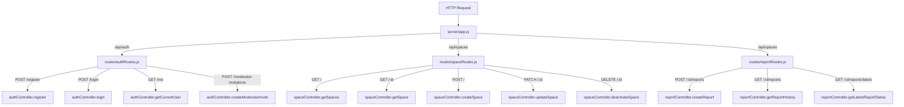
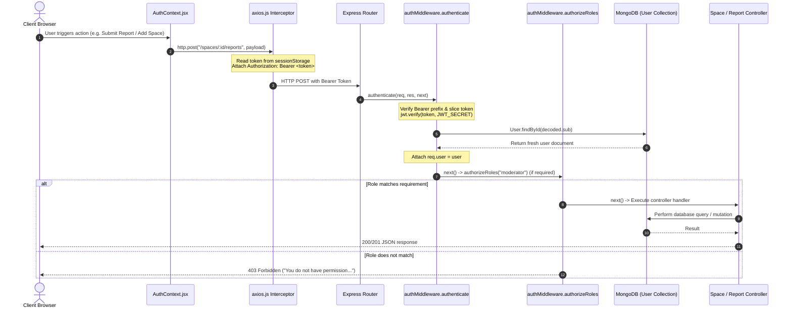
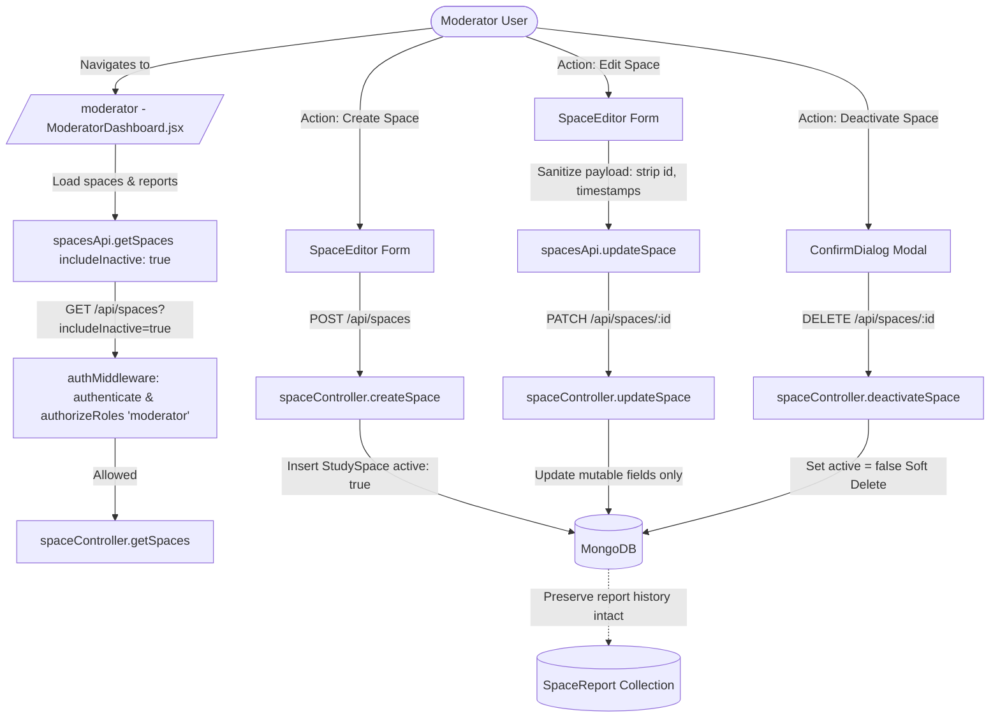
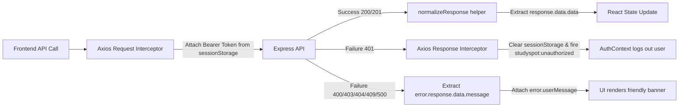

# StudySpot Codebase Map & Technical Architecture Document

> **Document Type:** Comprehensive Technical Presentation & Codebase Map  
> **Project:** StudySpot (College Project)  
> **Architecture:** MERN Stack (React/Vite Frontend + Express/Node.js Backend + MongoDB/Mongoose Persistence)  
> **Inspection Date:** 2026-11-03  
> **Authorship / Team:** 5 Team Members (Documented in `docs/TEAM_RESPONSIBILITIES.md` and verified against Git repository history)

---

## 1. Complete Directory Structure

```text
studyspot/
├── .env.example                               # Root environment configuration template
├── .gitignore                                 # Git ignore patterns (node_modules, dist, etc.)
├── README.md                                  # Top-level project overview, instructions, feature summaries
├── STUDYSPOT_CODEBASE_MAP.md                  # This technical codebase map and architecture specification
│
├── client/                                    # Frontend application (React 18, Vite 6, React Router 6)
│   ├── .env                                   # Active client environment variables (VITE_*)
│   ├── .env.example                           # Client environment variable template
│   ├── index.html                             # Single Page Application HTML entry point
│   ├── package.json                           # Client dependencies, scripts (dev, build, preview, test)
│   ├── package-lock.json                      # Client locked dependency tree
│   ├── vite.config.js                         # Vite build configuration (React plugin, test environment: jsdom)
│   └── src/
│       ├── main.jsx                           # React DOM mount, BrowserRouter & AuthProvider wrapping
│       ├── App.jsx                            # Route definitions & layout composition
│       │
│       ├── api/                               # HTTP client & backend adapter layer
│       │   ├── axios.js                       # Axios instance, interceptors, error normalization
│       │   ├── authApi.js                     # Authentication API adapter (login, register, me, logout)
│       │   ├── spacesApi.js                   # Study space API adapter (CRUD, filters, sample reset)
│       │   └── reportsApi.js                  # Availability report API adapter (submission, history)
│       │
│       ├── components/                        # Reusable React UI components
│       │   ├── ConfirmDialog.jsx              # Modal confirmation dialog for critical actions
│       │   ├── EmptyState.jsx                 # Visual placeholder when lists/results are empty
│       │   ├── ErrorState.jsx                 # Visual error boundary card with retry callback
│       │   ├── Footer.jsx                     # Site footer with project disclaimer
│       │   ├── FreshnessBadge.jsx             # Visual pill for report freshness (fresh / stale / none)
│       │   ├── LoadingState.jsx               # Animated spinner and state message
│       │   ├── ModeratorRoute.jsx             # Route guard requiring signed-in user with moderator role
│       │   ├── Navbar.jsx                     # Header navigation with responsive menu & auth controls
│       │   ├── ProtectedRoute.jsx             # Route guard requiring any authenticated user
│       │   ├── ReportForm.jsx                 # Form for submitting space availability updates
│       │   ├── ReportHistory.jsx              # Ordered list rendering past community reports
│       │   ├── SearchFilters.jsx              # Filter controls (search text, building, area, status, tags)
│       │   ├── SpaceCard.jsx                  # Catalog card displaying space summary & latest status
│       │   ├── StatusBadge.jsx                # Visual badge for availability status
│       │   └── Toast.jsx                      # Pop-up notification for asynchronous feedback
│       │
│       ├── context/                           # React Context state management
│       │   └── AuthContext.jsx                # Authentication provider, session restoration, role helpers
│       │
│       ├── data/                              # Static mock sample datasets (for development mock mode)
│       │   ├── mockReports.js                 # Sample space availability reports
│       │   ├── mockSpaces.js                  # Sample campus study spaces
│       │   └── mockUsers.js                   # Sample demo users (student & moderator credentials)
│       │
│       ├── layouts/                           # Application page shell
│       │   └── MainLayout.jsx                 # Layout wrapper housing Navbar, main Outlet, and Footer
│       │
│       ├── pages/                             # Top-level route pages
│       │   ├── HomePage.jsx                   # Marketing landing page with hero, visual sample & CTA
│       │   ├── LoginPage.jsx                  # User login form with mock/real notice
│       │   ├── RegisterPage.jsx               # Registration form with optional moderator invitation token
│       │   ├── SpacesPage.jsx                 # Searchable, filterable catalog directory
│       │   ├── SpaceDetailsPage.jsx           # Individual space view, facilities, latest report & form
│       │   ├── ModeratorDashboard.jsx         # Moderator space management, CRUD, stats, deactivation
│       │   └── NotFoundPage.jsx               # 404 fallback page
│       │
│       ├── services/                          # Browser mock-mode implementation (localStorage)
│       │   ├── mockAuthService.js             # Mock authentication against localStorage / mockUsers
│       │   ├── mockReportService.js           # Mock report creation and querying
│       │   ├── mockSpaceService.js            # Mock study-space filtering and CRUD
│       │   └── mockStorage.js                 # LocalStorage persistence manager & sample reset helper
│       │
│       ├── styles/                            # CSS stylesheets
│       │   ├── globals.css                    # Typography, CSS variables, utility classes, layout
│       │   └── components.css                 # Component-specific styles (cards, tables, badges, navbar)
│       │
│       ├── test/                              # Frontend Vitest test suite (17 tests)
│       │   ├── setup.js                       # Test environment setup (@testing-library/jest-dom)
│       │   ├── forms-and-routes.test.jsx      # Form validations & access control routes tests
│       │   ├── moderator-scroll.test.jsx      # Moderator editor DOM scroll & interaction tests
│       │   ├── moderator-space-edit.test.jsx  # Space edit payload sanitization regression test
│       │   ├── services.test.js               # Mock service layer behavior tests
│       │   ├── status-report-page.test.jsx    # Status report UI rendering & update tests
│       │   └── statusUtils.test.js            # Pure utility function tests (freshness, sorting, filters)
│       │
│       └── utils/                             # Pure frontend helper functions
│           ├── dateUtils.js                   # Date and time formatting (`formatDate`, relative timestamps)
│           ├── statusUtils.js                 # Freshness calculation, sorting, and multi-field filtering
│           └── validation.js                  # Client-side input validation schemas and rules
│
├── server/                                    # Backend application (Node.js, Express, Mongoose)
│   ├── .env                                   # Server environment variables (fallback configuration)
│   ├── .env.example                           # Server environment template (port, mongo URI, secret)
│   ├── app.js                                 # Express application setup, middleware, route mounting, errors
│   ├── package.json                           # Server dependencies and test/seed scripts
│   ├── package-lock.json                      # Server locked dependency tree
│   ├── README.md                              # Backend configuration, seed documentation, architecture notes
│   ├── server.js                              # HTTP listener entry point, config loader, MongoDB bootstrapper
│   │
│   ├── scripts/                               # Maintenance & database utilities
│   │   └── seed.js                            # Idempotent database seeder (upserts 5 spaces, 5 reports, 1 reporter)
│   │
│   ├── src/
│   │   ├── config/
│   │   │   └── db.js                          # Mongoose connection bootstrapper using `MONGO_URI`
│   │   │
│   │   ├── controllers/                       # Express request controllers
│   │   │   ├── authController.js              # Register, login, me, and moderator invitation endpoints
│   │   │   ├── reportController.js            # Report submission, history pagination, latest report status
│   │   │   └── spaceController.js             # Space directory, search, retrieval, create, update, deactivate
│   │   │
│   │   ├── middleware/                        # Express middleware
│   │   │   └── authMiddleware.js              # JWT Bearer token authentication & role-based authorization
│   │   │
│   │   ├── models/                            # Mongoose Data Models
│   │   │   ├── ModeratorInvitation.js         # Token hash, expiration, and single-use state
│   │   │   ├── SpaceReport.js                 # Space reference, reporter reference, status, note, timestamp
│   │   │   ├── StudySpace.js                  # Space attributes, facilities, quiet/group flags, active flag
│   │   │   └── User.js                        # User credentials, name, email, hashed password, role
│   │   │
│   │   ├── routes/                            # Express router definitions
│   │   │   ├── authRoutes.js                  # Endpoints mounted at `/api/auth`
│   │   │   ├── reportRoutes.js                # Endpoints mounted under `/api/spaces`
│   │   │   └── spaceRoutes.js                 # Endpoints mounted under `/api/spaces`
│   │   │
│   │   ├── services/                          # Business logic services
│   │   │   ├── authService.js                 # Password hashing, JWT creation, transaction registration
│   │   │   ├── moderatorInvitationService.js  # Token generation, SHA-256 hashing, atomic consumption
│   │   │   └── statusService.js               # Report freshness calculation, latest report resolution
│   │   │
│   │   └── utils/                             # Shared backend utilities
│   │       └── reportConstants.js             # Canonical `REPORT_STATUSES` enum array
│   │
│   └── tests/                                 # Backend Node test runner suite (Supertest, in-memory MongoDB - 41 tests)
│       ├── auth.test.js                       # 15 tests covering registration, login, JWTs, invitations
│       ├── reports.test.js                    # 16 tests covering report submission, pagination, freshness
│       ├── seed.test.js                       # 1 test verifying seeder idempotence
│       └── spaces.test.js                     # 9 tests covering space CRUD, validation, soft deactivation
│
├── docs/                                      # Project documentation & records
│   ├── API.md                                 # Full REST API specification and contracts
│   ├── QA-REPORT-2026-11-03.md                # Comprehensive end-to-end live testing & QA audit report
│   ├── TEAM_RESPONSIBILITIES.md               # Detailed mapping of all 5 team roles and technical tasks
│   └── TESTING.md                             # Testing instructions and test scope overview
│
└── screenshots/                               # Project screenshots directory
    └── README.md                              # Screenshot placement guide
```

---

## 2. Purpose of Every Important Source File

### Root & Documentation
- **`studyspot/README.md`**: Primary documentation outlining project architecture, installation, demo accounts, feature capabilities, and security boundaries.
- **`docs/TEAM_RESPONSIBILITIES.md`**: Master responsibility document formalizing individual tasks, code ownership, module mapping, and deliverables for Members 1 through 5.
- **`docs/API.md`**: API specification outlining all request/response JSON contracts, query parameters, error responses, and HTTP status codes.
- **`docs/QA-REPORT-2026-11-03.md`**: Verified live and automated test execution report covering 41 backend tests, 17 frontend tests, live Atlas verification, and regression bug fixes.
- **`docs/TESTING.md`**: Developer reference explaining how to run backend and frontend test runners.

### Backend (`server/`)
- **`server/server.js`**: Application entry point. Loads hierarchical environment variables (from `%LOCALAPPDATA%/StudySpot/server.env` or local `.env`), connects to MongoDB via `connectDB()`, and starts the HTTP server on port 5000.
- **`server/app.js`**: Express application factory. Configures CORS (`origin` from `CLIENT_URL`), JSON parsing with body-size error handling, registers models, mounts route modules (`/api/auth`, `/api/spaces`), provides a health check (`/api/health`), a 404 handler, and global JSON error formatting.
- **`server/src/config/db.js`**: Database connection helper wrapping `mongoose.connect(process.env.MONGO_URI)` with error handling and process termination on fatal failures.
- **`server/src/models/User.js`**: Mongoose model for student and moderator accounts (`name`, `email`, hidden `passwordHash`, `role`).
- **`server/src/models/StudySpace.js`**: Mongoose model for campus spaces (`name`, `building`, `area`, `description`, `facilities`, `quietZone`, `groupStudyAllowed`, `active`, indexes).
- **`server/src/models/SpaceReport.js`**: Mongoose model for community updates (`spaceId`, `reporterId`, `status`, `note`, `reportedAt`).
- **`server/src/models/ModeratorInvitation.js`**: Mongoose model for secure moderator invites (`tokenHash`, `expiresAt`, `usedAt`, TTL index).
- **`server/src/controllers/authController.js`**: Handles registration, login, current authenticated user retrieval, and moderator invite link generation.
- **`server/src/controllers/spaceController.js`**: Handles listing spaces with multi-parameter filtering, individual space retrieval, moderator space creation, updates, and soft-deactivation.
- **`server/src/controllers/reportController.js`**: Handles validated report submission, paginated space report history, and latest status calculation.
- **`server/src/services/authService.js`**: Core authentication service handling bcrypt password hashing, credential verification, JWT issuance (`1d`), and transactional moderator invitation consumption.
- **`server/src/services/moderatorInvitationService.js`**: Generates secure random 32-byte tokens, SHA-256 hashes, sets 24-hour expiration, and atomically consumes invites via transactions.
- **`server/src/services/statusService.js`**: Calculates report freshness (`Fresh` vs `Stale` vs `No Report`) against `STATUS_STALE_AFTER_MINUTES` (default 60) without mutating stored records.
- **`server/src/middleware/authMiddleware.js`**: Express middleware functions: `authenticate` (validates Bearer JWT and reloads current user from DB) and `authorizeRoles` (enforces role check, e.g., `moderator`).
- **`server/src/routes/authRoutes.js`**: Route definitions for `/register`, `/login`, `/me`, and `/moderator-invitations`.
- **`server/src/routes/spaceRoutes.js`**: Route definitions for `/` (GET, POST), `/:id` (GET, PATCH, DELETE) with role gating.
- **`server/src/routes/reportRoutes.js`**: Route definitions for `/:id/reports` (POST, GET) and `/:id/reports/latest` (GET).
- **`server/src/utils/reportConstants.js`**: Single source of truth for valid status strings (`Available`, `Moderately Busy`, `Busy`, `Temporarily Closed`).
- **`server/scripts/seed.js`**: Standalone idempotent script to seed 5 campus spaces, initial reports, and a seed reporter account.

### Frontend (`client/`)
- **`client/src/main.jsx`**: Browser entry point; renders `<App />` within `<BrowserRouter>` and `<AuthProvider>`.
- **`client/src/App.jsx`**: Top-level route switch, mapping paths to pages and nesting protected/moderator route guards inside `<MainLayout />`.
- **`client/src/layouts/MainLayout.jsx`**: Structural shell providing standard top `<Navbar />`, center `<Outlet />`, and bottom `<Footer />`.
- **`client/src/context/AuthContext.jsx`**: Central React context managing active `user`, `loading`, `login`, `register`, `logout`, and computed `isModerator`.
- **`client/src/api/axios.js`**: Configures Axios instance (`baseURL`), request interceptor for `Bearer` header injection, 401 response interceptor for session clearance, and error message normalization.
- **`client/src/api/authApi.js`**: Dispatches auth requests to backend or mock services; persists token and user in `sessionStorage`.
- **`client/src/api/spacesApi.js`**: Dispatches study-space requests (filter, get, create, patch, delete) to live backend or mock services.
- **`client/src/api/reportsApi.js`**: Dispatches report submission and history retrieval requests to live backend or mock services.
- **`client/src/pages/HomePage.jsx`**: Landing page presenting hero banner, campus illustration, features breakdown, and navigation links.
- **`client/src/pages/SpacesPage.jsx`**: Primary directory page with search filters, dynamic options, space card grid, empty states, and loading states.
- **`client/src/pages/SpaceDetailsPage.jsx`**: Space details view showing attributes, facilities, latest community report, freshness badge, report history, and the submission form.
- **`client/src/pages/ModeratorDashboard.jsx`**: Comprehensive moderator interface featuring space metrics, list table, create/edit form, deactivation modal, and sample reset.
- **`client/src/pages/LoginPage.jsx`**: Authentication page handling student and moderator login.
- **`client/src/pages/RegisterPage.jsx`**: Registration page supporting member signup and invitation-based moderator registration (`?invite=...`).
- **`client/src/pages/NotFoundPage.jsx`**: Fallback 404 view for unmatched routes.
- **`client/src/utils/statusUtils.js`**: Logic for evaluating report freshness against threshold, finding latest report by timestamp, and filtering space lists.
- **`client/src/utils/validation.js`**: Form validation functions for login, registration, reports, and study space payloads.
- **`client/src/utils/dateUtils.js`**: Date formatting helpers for displaying relative and localized timestamps.

---

## 3. Frontend Pages and Components

### Frontend Pages (`client/src/pages/`)

| Page Component | Route Path | Access Level | Description | Key State & Hooks |
|---|---|---|---|---|
| `HomePage` | `/` | Public | Visual landing page with value proposition, sample cards, and call-to-actions. | Static layout, Lucide icons, `Link` |
| `SpacesPage` | `/spaces` | Public | Searchable, filterable directory of active campus study spaces. | `filters`, `spaces`, `catalogSpaces`, `reports`, `loading`, `error`, `useCallback`, `useMemo` |
| `SpaceDetailsPage` | `/spaces/:id` | Public (Submit: Authenticated) | Full view of a selected space, facilities, live latest report, freshness badge, history list, and submission form. | `space`, `reports`, `now` (60s tick interval), `loading`, `error`, `useParams`, `useAuth` |
| `ModeratorDashboard` | `/moderator` | Moderator Only | Management portal for campus spaces: metrics summary, search, active/inactive filter, create/edit space form, and soft deactivation. | `spaces`, `reports`, `editing`, `visibility`, `search`, `deactivating`, `toast`, `formRef` |
| `LoginPage` | `/login` | Public (Unauthenticated) | Login form accepting email and password; redirects to target route or `/spaces`. | `values`, `errors`, `requestError`, `submitting`, `showPassword`, `useAuth`, `useNavigate`, `useLocation` |
| `RegisterPage` | `/register` | Public (Unauthenticated) | Registration form for new members; automatically captures `?invite=<token>` for moderator assignment. | `values`, `errors`, `requestError`, `submitting`, `useSearchParams`, `useAuth`, `useNavigate` |
| `NotFoundPage` | `*` | Public | Fallback error page with quick navigation back to `/spaces`. | Static layout, `Link` |

### Frontend UI Components (`client/src/components/`)

| Component | Purpose | Props / Interface |
|---|---|---|
| `Navbar` | Persistent site header with branding, navigation links, responsive mobile menu, user profile, and logout button. | Uses `useAuth()`, `useNavigate()` |
| `Footer` | Bottom site disclaimer emphasizing community-reported status vs live sensors. | None |
| `ProtectedRoute` | Route guard that checks if a user is authenticated; redirects unauthenticated visitors to `/login`. | Outlets children via React Router `Outlet` |
| `ModeratorRoute` | Route guard that checks if the authenticated user has `isModerator === true`; redirects members to `/spaces` and unauthenticated visitors to `/login`. | Outlets children via React Router `Outlet` |
| `SpaceCard` | Card component for catalog view displaying name, building, area, tags, facilities snippet, and latest status/freshness. | `space`: Object, `reports`: Array |
| `StatusBadge` | Visual pill displaying availability status with color coding (Green: Available, Yellow: Moderately Busy, Orange: Busy, Gray: Temporarily Closed). | `status`: String |
| `FreshnessBadge` | Visual pill indicating whether report timestamp is within the freshness threshold (`fresh`, `stale`, or `none`). | `timestamp`: Date/String, `now`: Number, `reportedFreshness`: String, `reportedThresholdMinutes`: Number |
| `ReportForm` | Interactive form allowing signed-in users to pick one of 4 statuses and enter an optional note (up to 300 chars). | `onSubmit`: Function(data) |
| `ReportHistory` | Chronological list (newest first) displaying past availability reports with reporter names, notes, and relative times. | `reports`: Array, `now`: Number |
| `SearchFilters` | Input controls: keyword search, building dropdown, area dropdown, status dropdown, facility dropdown, and boolean checkboxes. | `filters`: Object, `options`: Object, `onChange`: Function, `onClear`: Function |
| `ConfirmDialog` | Accessible confirmation modal dialog for high-impact actions like space deactivation or sample reset. | `title`: String, `message`: String, `confirmLabel`: String, `onCancel`: Function, `onConfirm`: Function, `busy`: Boolean |
| `Toast` | Transient alert banner displaying success or error messages with auto-dismiss. | `message`: String, `type`: "success" \| "error", `onClose`: Function |
| `LoadingState` | Accessible loading indicator with animated spinner and status text. | `label`: String |
| `ErrorState` | Error display banner with warning icon, message, and retry button. | `message`: String, `onRetry`: Function |
| `EmptyState` | Informational placeholder when a query or filter returns zero items. | `title`: String, `children`: ReactNode |

---

## 4. Frontend API Service Functions

The frontend provides an abstraction layer in `client/src/api/` that switches between live HTTP calls (`client/src/api/axios.js`) and local browser storage (`client/src/services/mock*Service.js`) based on `import.meta.env.VITE_USE_MOCK_API !== "false"`.

### 1. `client/src/api/axios.js`
- **`http`**: Preconfigured Axios instance with `baseURL = import.meta.env.VITE_API_BASE_URL || "http://localhost:5000/api"`.
  - **Request Interceptor**: Extracts `studyspot-api-token` from `sessionStorage` and attaches `Authorization: Bearer <token>`.
  - **Response Interceptor**: Intercepts HTTP 401 responses, removes `studyspot-api-token` and `studyspot-api-user` from `sessionStorage`, and dispatches a global window event `studyspot:unauthorized` to reset `AuthContext`.
  - Attaches `error.userMessage` derived from server response `message` or a fallback status code dictionary.
- **`normalizeResponse(response)`**: Extracts `response.data.data` if present, falling back to `response.data`.

### 2. `client/src/api/authApi.js`
- **`login(credentials)`**: Sends `POST /api/auth/login`. On success, stores JWT in `sessionStorage` under `studyspot-api-token` and serialized user object under `studyspot-api-user`. Returns `user`.
- **`register(userData)`**: Sends `POST /api/auth/register` with `name`, `email`, `password`, `confirmPassword`, and optional `invitationToken`. On success, stores token and user in `sessionStorage`. Returns `user`.
- **`logout()`**: Removes `studyspot-api-token` and `studyspot-api-user` from `sessionStorage`.
- **`getCurrentUser()`**: Sends `GET /api/auth/me`. If token exists, re-syncs user in `sessionStorage` and returns `user`. If no token, returns `null`.

### 3. `client/src/api/spacesApi.js`
- **`getSpaces(filters = {})`**: Strips empty filter parameters and sends `GET /api/spaces` with query parameters. Returns array of spaces.
- **`getSpaceById(id)`**: Sends `GET /api/spaces/:id`. Returns single space object.
- **`createSpace(data)`**: Moderator only. Sends `POST /api/spaces` with space payload. Returns created space.
- **`updateSpace(id, data)`**: Moderator only. Sends `PATCH /api/spaces/:id` with sanitized editable fields. Returns updated space.
- **`deactivateSpace(id)`**: Moderator only. Sends `DELETE /api/spaces/:id` (performs soft delete). Returns deactivated space.
- **`resetSampleData()`**: Mock-mode only helper; restores initial spaces and reports in `localStorage`. Throws error if called in live API mode.

### 4. `client/src/api/reportsApi.js`
- **`getSpaceReports(spaceId)`**: Sends `GET /api/spaces/:id/reports`. Returns array of report objects ordered newest first.
- **`createSpaceReport(spaceId, reportData, reporter)`**: Authenticated member/moderator. Sends `POST /api/spaces/:id/reports` with `{ status, note }`. Returns created report object.

---

## 5. Backend Routes and Endpoints

| HTTP Method | Full Endpoint Path | Router File | Authentication | Authorization | Request Body / Query Params | Success Code & Envelope |
|---|---|---|---|---|---|---|
| `GET` | `/api/health` | `server/app.js` | None | Public | None | `200 OK`<br>`{ success: true, message, status: "OK" }` |
| `GET` | `/` | `server/app.js` | None | Public | None | `200 OK`<br>`"Welcome to StudySpot API"` |
| `POST` | `/api/auth/register` | `src/routes/authRoutes.js` | None | Public | `{ name, email, password, confirmPassword, invitationToken? }` | `201 Created`<br>`{ success: true, data: { user, token } }` |
| `POST` | `/api/auth/login` | `src/routes/authRoutes.js` | None | Public | `{ email, password }` | `200 OK`<br>`{ success: true, data: { user, token } }` |
| `GET` | `/api/auth/me` | `src/routes/authRoutes.js` | Bearer JWT | Member or Moderator | None | `200 OK`<br>`{ success: true, data: { user } }` |
| `POST` | `/api/auth/moderator-invitations` | `src/routes/authRoutes.js` | Bearer JWT | Moderator Only | None | `201 Created`<br>`{ success: true, data: { invitationLink, expiresAt } }` |
| `GET` | `/api/spaces` | `src/routes/spaceRoutes.js` | Optional (if `includeInactive=true`) | Public (Moderator if `includeInactive=true`) | Query: `search, building, area, facility, status, quietZone, groupStudyAllowed, includeInactive` | `200 OK`<br>`{ success: true, data: { spaces: [...] } }` |
| `GET` | `/api/spaces/:id` | `src/routes/spaceRoutes.js` | None | Public | Path: `:id` (MongoDB ObjectId) | `200 OK`<br>`{ success: true, data: { space: {...} } }` |
| `POST` | `/api/spaces` | `src/routes/spaceRoutes.js` | Bearer JWT | Moderator Only | `{ name, building, area, description, facilities, quietZone?, groupStudyAllowed?, active? }` | `201 Created`<br>`{ success: true, data: { space: {...} } }` |
| `PATCH` | `/api/spaces/:id` | `src/routes/spaceRoutes.js` | Bearer JWT | Moderator Only | Path: `:id`<br>Body: Subset of editable space fields | `200 OK`<br>`{ success: true, data: { space: {...} } }` |
| `DELETE` | `/api/spaces/:id` | `src/routes/spaceRoutes.js` | Bearer JWT | Moderator Only | Path: `:id` | `200 OK`<br>`{ success: true, data: { space: { active: false, ... } } }` |
| `POST` | `/api/spaces/:id/reports` | `src/routes/reportRoutes.js` | Bearer JWT | Member or Moderator | Path: `:id`<br>Body: `{ status, note? }` | `201 Created`<br>`{ success: true, data: { report: {...} } }` |
| `GET` | `/api/spaces/:id/reports` | `src/routes/reportRoutes.js` | None | Public | Path: `:id`<br>Query: `page?` (default 1), `limit?` (default 10) | `200 OK`<br>`{ success: true, data: { reports: [...], pagination: {...} } }` |
| `GET` | `/api/spaces/:id/reports/latest` | `src/routes/reportRoutes.js` | None | Public | Path: `:id` | `200 OK`<br>`{ success: true, data: { report, status, reportedAt, freshness } }` |

---

## 6. Route-to-Controller Mapping



### Detailed Route-to-Controller Matrix

1. **`POST /api/auth/register`**
   - Middleware: None
   - Controller Method: `authController.register`
   - Purpose: Validates name (2-80 chars), email regex, password length (8-72 chars), password match, and delegates registration to `authService.register`.
2. **`POST /api/auth/login`**
   - Middleware: None
   - Controller Method: `authController.login`
   - Purpose: Validates email and password presence, delegates verification to `authService.login`.
3. **`GET /api/auth/me`**
   - Middleware: `authenticate`
   - Controller Method: `authController.getCurrentUser`
   - Purpose: Returns the public representation of `req.user`.
4. **`POST /api/auth/moderator-invitations`**
   - Middleware: `authenticate`, `authorizeRoles("moderator")`
   - Controller Method: `authController.createModeratorInvite`
   - Purpose: Generates a 24-hour single-use token and returns a registration URL with `?invite=token`.
5. **`GET /api/spaces`**
   - Middleware: Inline condition checking `includeInactive`. If `"true"`, executes `authenticate` and `authorizeRoles("moderator")`.
   - Controller Method: `spaceController.getSpaces`
   - Purpose: Filters spaces by active status, building, area, facility, quietZone, groupStudyAllowed, and latest report status.
6. **`GET /api/spaces/:id`**
   - Middleware: None
   - Controller Method: `spaceController.getSpace`
   - Purpose: Validates ObjectId and returns active space document.
7. **`POST /api/spaces`**
   - Middleware: `authenticate`, `authorizeRoles("moderator")`
   - Controller Method: `spaceController.createSpace`
   - Purpose: Validates space fields and creates new active space.
8. **`PATCH /api/spaces/:id`**
   - Middleware: `authenticate`, `authorizeRoles("moderator")`
   - Controller Method: `spaceController.updateSpace`
   - Purpose: Validates only supplied fields (rejecting unknown keys such as `id` or timestamps) and saves updates.
9. **`DELETE /api/spaces/:id`**
   - Middleware: `authenticate`, `authorizeRoles("moderator")`
   - Controller Method: `spaceController.deactivateSpace`
   - Purpose: Soft-deletes space by setting `active = false` without removing documents or reports.
10. **`POST /api/spaces/:id/reports`**
    - Middleware: `authenticate`
    - Controller Method: `reportController.createReport`
    - Purpose: Validates status against `REPORT_STATUSES`, trims note (<=300 chars), verifies active space, and creates report.
11. **`GET /api/spaces/:id/reports`**
    - Middleware: None
    - Controller Method: `reportController.getReportHistory`
    - Purpose: Paginates report documents sorted newest first, populating reporter name.
12. **`GET /api/spaces/:id/reports/latest`**
    - Middleware: None
    - Controller Method: `reportController.getLatestReportStatus`
    - Purpose: Finds latest report, computes freshness (`Fresh` / `Stale` / `No Report`), and returns summary.

---

## 7. Controller-to-Model Mapping

| Controller File | Controller Function | Mongoose Models Invoked | Operations Performed | Fields Read / Modified |
|---|---|---|---|---|
| `authController.js` (via `authService.js`) | `register` | `User`, `ModeratorInvitation` | `User.findOne`, `User.create`, `ModeratorInvitation.findOneAndUpdate` | Checks unique email; creates user document; updates invitation `usedAt` within a transaction |
| `authController.js` (via `authService.js`) | `login` | `User` | `User.findOne({ email }).select("+passwordHash")` | Reads `passwordHash`, compares bcrypt hash, generates JWT |
| `authController.js` | `getCurrentUser` | `User` | Sourced from `req.user` (loaded in `authMiddleware.js` via `User.findById(decoded.sub)`) | Reads `_id`, `name`, `email`, `role` |
| `authController.js` (via `moderatorInvitationService.js`) | `createModeratorInvite` | `ModeratorInvitation` | `ModeratorInvitation.create` | Stores SHA-256 `tokenHash`, `expiresAt` |
| `spaceController.js` | `getSpaces` | `StudySpace`, `SpaceReport` | `SpaceReport.aggregate`, `StudySpace.find().sort()` | If status filter: aggregates latest report per space; finds active/filtered `StudySpace` documents |
| `spaceController.js` | `getSpace` | `StudySpace` | `StudySpace.findOne({ _id, active: true })` | Retrieves single active space |
| `spaceController.js` | `createSpace` | `StudySpace` | `StudySpace.create` | Inserts new `StudySpace` document |
| `spaceController.js` | `updateSpace` | `StudySpace` | `StudySpace.findById`, `space.save()` | Updates mutable fields and updates `updatedAt` |
| `spaceController.js` | `deactivateSpace` | `StudySpace` | `StudySpace.findById`, `space.save()` | Sets `active = false` |
| `reportController.js` | `createReport` | `StudySpace`, `SpaceReport` | `StudySpace.findOne`, `new SpaceReport()`, `report.save()`, `report.populate("reporterId", "name")` | Validates active space; inserts report with `reporterId = req.user._id`; returns populated record |
| `reportController.js` | `getReportHistory` | `StudySpace`, `SpaceReport` | `StudySpace.findById`, `SpaceReport.find().sort().skip().limit().populate()`, `SpaceReport.countDocuments` | Reads paginated reports sorted by `{ reportedAt: -1, _id: -1 }` |
| `reportController.js` (via `statusService.js`) | `getLatestReportStatus` | `StudySpace`, `SpaceReport` | `StudySpace.findById`, `SpaceReport.findOne().sort().populate()` | Reads newest report document; calculates freshness without DB write |

---

## 8. MongoDB Schemas and Fields

### 1. `User` Schema (`server/src/models/User.js`)
Collection Name: `users`  
Options: `{ timestamps: true, versionKey: false }`

| Field | BSON Type | Constraints & Validation | Default | Purpose |
|---|---|---|---|---|
| `_id` | ObjectId | Auto-generated primary key | Auto | Unique user identifier |
| `name` | String | `required: true`, `trim: true`, `minlength: 2`, `maxlength: 80` | None | Full display name |
| `email` | String | `required: true`, `unique: true`, `lowercase: true`, `trim: true`, `maxlength: 254`, Regex: `/^[^\s@]+@[^\s@]+\.[^\s@]+$/` | None | Unique login email |
| `passwordHash` | String | `required: true`, `select: false` | None | Bcrypt hashed password (12 salt rounds); hidden by default from queries |
| `role` | String | `required: true`, `enum: ["member", "moderator"]` | `"member"` | Authorization role |
| `createdAt` | Date | Auto-populated by Mongoose timestamps | `Date.now` | Account creation timestamp |
| `updatedAt` | Date | Auto-populated by Mongoose timestamps | `Date.now` | Last update timestamp |

### 2. `StudySpace` Schema (`server/src/models/StudySpace.js`)
Collection Name: `studyspaces`  
Options: `{ timestamps: true, versionKey: false }`

| Field | BSON Type | Constraints & Validation | Default | Purpose |
|---|---|---|---|---|
| `_id` | ObjectId | Auto-generated primary key | Auto | Unique study space identifier |
| `name` | String | `required: true`, `trim: true`, `minlength: 1`, `maxlength: 120` | None | Name of the space (e.g. Central Library) |
| `building` | String | `required: true`, `trim: true`, `minlength: 1`, `maxlength: 120` | None | Campus building (e.g. Main Block) |
| `area` | String | `required: true`, `trim: true`, `minlength: 1`, `maxlength: 120` | None | Floor/wing (e.g. Level 2 · East Wing) |
| `description`| String | `required: true`, `trim: true`, `minlength: 1`, `maxlength: 2000` | None | Space description and rules |
| `facilities` | Array of Strings | Items: `trim: true`, `minlength: 1`, `maxlength: 80` | `[]` | Amenities (e.g. Wi-Fi, Power outlets) |
| `quietZone` | Boolean | `required: true` | `false` | Indicates whether silence is enforced |
| `groupStudyAllowed` | Boolean | `required: true` | `false` | Indicates if collaboration is permitted |
| `active` | Boolean | `required: true` | `true` | Listing visibility (soft delete flag) |
| `createdAt` | Date | Auto-populated by Mongoose timestamps | `Date.now` | Space creation timestamp |
| `updatedAt` | Date | Auto-populated by Mongoose timestamps | `Date.now` | Last space modification timestamp |

**Indexes:**
- Compound Index: `{ active: 1, building: 1, area: 1 }`
- Single Field Index: `{ facilities: 1 }`

### 3. `SpaceReport` Schema (`server/src/models/SpaceReport.js`)
Collection Name: `spacereports`  
Options: `{ versionKey: false }`

| Field | BSON Type | Constraints & Validation | Default | Purpose |
|---|---|---|---|---|
| `_id` | ObjectId | Auto-generated primary key | Auto | Unique report identifier |
| `spaceId` | ObjectId | `required: true`, `ref: "StudySpace"` | None | Foreign reference to target `StudySpace` |
| `reporterId` | ObjectId | `required: true`, `ref: "User"` | None | Foreign reference to reporting `User` |
| `status` | String | `required: true`, `enum: REPORT_STATUSES` | None | One of: `"Available"`, `"Moderately Busy"`, `"Busy"`, `"Temporarily Closed"` |
| `note` | String | `trim: true`, `maxlength: 300`, Non-empty validator | `undefined` | Optional user observations |
| `reportedAt` | Date | `required: true` | `Date.now` | Timestamp of community report |

**Indexes:**
- Compound Index: `{ spaceId: 1, reportedAt: -1 }` (Optimizes latest-report resolution and chronologically ordered history queries)

### 4. `ModeratorInvitation` Schema (`server/src/models/ModeratorInvitation.js`)
Collection Name: `moderatorinvitations`  
Options: `{ timestamps: true }`

| Field | BSON Type | Constraints & Validation | Default | Purpose |
|---|---|---|---|---|
| `_id` | ObjectId | Auto-generated primary key | Auto | Unique invitation record identifier |
| `tokenHash` | String | `required: true`, `unique: true` | None | SHA-256 digest of the 32-byte hex token |
| `expiresAt` | Date | `required: true` | None | Expiration time (24 hours from creation) |
| `usedAt` | Date | Nullable | `null` | Consumption timestamp |
| `createdAt` | Date | Auto-populated by Mongoose timestamps | `Date.now` | Invite generation timestamp |
| `updatedAt` | Date | Auto-populated by Mongoose timestamps | `Date.now` | Last update timestamp |

**Indexes:**
- TTL Index: `{ expiresAt: 1 }` with `{ expireAfterSeconds: 0 }` (Automatically purges expired invitation documents via MongoDB background thread)
- Unique Index: `{ tokenHash: 1 }`

---

## 9. Complete Member Registration and Login Flow

### Flow A: Member Registration Execution Path
1. **User Action:** User navigates to `/register`, fills out `RegisterPage.jsx` (`name`, `email`, `password`, `confirmPassword`), and clicks "Create account".
2. **Client Validation:** `RegisterPage.submit` calls `validateRegistration(values)` from `validation.js`:
   - Checks non-empty `name`, regex-valid `email`, `password.length >= 8`, and `password === confirmPassword`.
3. **API Dispatch:** `RegisterPage.jsx` calls `register` from `AuthContext.jsx`, which delegates to `authApi.register(userData)` in `client/src/api/authApi.js`.
4. **Network Request:** Axios sends `POST /api/auth/register` to Express backend.
5. **Backend Route & Controller:** `server/src/routes/authRoutes.js` routes request to `authController.register` in `server/src/controllers/authController.js`.
6. **Controller Validation:** Validates field types, lengths (2-80 name, 8-72 password), email format, and password matching.
7. **Service Layer Execution:** Controller calls `authService.register({ name, email, password, invitationToken })` in `server/src/services/authService.js`:
   - Normalizes email to lowercase.
   - Queries `User.findOne({ email: normalizedEmail })`. If found, throws `409 Conflict`.
   - Hashes password using `bcrypt.hash(password, 12)`.
   - Defaults `role: "member"`.
   - If `invitationToken` is present, starts a MongoDB session transaction, executes `consumeModeratorInvitation(token, session)`, and if valid, elevates role to `"moderator"`.
   - Inserts new user via `User.create()`.
   - Generates JWT using `jwt.sign({ sub: user._id, role: user.role }, JWT_SECRET, { expiresIn: "1d" })`.
8. **HTTP Response:** Returns `201 Created` with JSON `{ success: true, data: { token, user: { id, name, email, role } } }`.
9. **Client Storage & State:**
   - `authApi.register` stores token in `sessionStorage.setItem("studyspot-api-token", token)` and user in `sessionStorage.setItem("studyspot-api-user", JSON.stringify(user))`.
   - `AuthContext` updates `setUser(user)`.
   - `RegisterPage.jsx` executes `navigate("/spaces", { replace: true })`.

### Flow B: Member & Moderator Login Execution Path
1. **User Action:** User enters credentials into `LoginPage.jsx` and clicks "Log in".
2. **Client Validation:** `LoginPage.submit` runs `validateLogin(values)` from `validation.js`.
3. **API Dispatch:** Calls `login(credentials)` in `AuthContext.jsx` -> `authApi.login` in `client/src/api/authApi.js`.
4. **Network Request:** Axios sends `POST /api/auth/login`.
5. **Backend Routing & Controller:** `authRoutes.js` routes to `authController.login`.
6. **Controller Validation:** Validates presence and types of `email` and `password`.
7. **Service Layer Execution:** Calls `authService.login({ email, password })`:
   - Executes `User.findOne({ email: normalizedEmail }).select("+passwordHash")`.
   - If user not found, throws `401 Unauthorized` with code `EMAIL_NOT_REGISTERED`.
   - Calls `bcrypt.compare(password, user.passwordHash)`.
   - If mismatch, throws `401 Unauthorized` with code `INVALID_PASSWORD`.
   - Calls `createToken(user)` to sign 1-day JWT.
8. **HTTP Response:** Returns `200 OK` with JSON envelope containing `{ token, user }`.
9. **Client Session Restoration:**
   - `authApi.login` sets `sessionStorage` keys.
   - `AuthContext` updates active `user` state.
   - User redirected to target path (e.g. `/spaces` or previously requested protected route from `location.state.from`).

---

## 10. JWT Authentication and Authorization Flow



### Detailed Token Lifecycle and Security Safeguards
1. **Signing:** Tokens are signed using HMAC-SHA256 with `process.env.JWT_SECRET` in `server/src/services/authService.js`.
2. **Payload:** `{ sub: user._id.toString(), role: user.role }`, expiring in `1d`.
3. **Transmission:** Passed in HTTP header `Authorization: Bearer <token>`.
4. **Verification:** In `server/src/middleware/authMiddleware.js`:
   - Checks header existence and `"Bearer "` prefix (returns `401` if missing).
   - Verifies signature and expiration using `jwt.verify(token, process.env.JWT_SECRET)`.
   - Queries MongoDB via `User.findById(decoded.sub)` to ensure the user still exists and roles are fresh. If user was deleted, returns `401 Unauthorized` (`"User account no longer exists."`).
   - Attaches Mongoose document to `req.user`.
5. **Role Gating:** `authorizeRoles(...allowedRoles)` compares `req.user.role`. If unauthorized, rejects immediately with `403 Forbidden`.
6. **Frontend Synchronization:** If an API call fails with `401`, Axios interceptor purges `sessionStorage` and triggers `window.dispatchEvent(new Event("studyspot:unauthorized"))`, causing `AuthContext` to instantly clear `user` and render signed-out navigation.

---

## 11. Study-Space Browsing and Detail Flow

### 1. Catalog Browsing (`SpacesPage.jsx`)
1. **Mount & Fetch:** `SpacesPage.jsx` initializes with filter defaults. `useEffect` triggers `loadSpaces()`.
2. **Parallel Requests:** Executes `Promise.all([ getSpaces(filters), getSpaces() ])` via `client/src/api/spacesApi.js`:
   - The first request fetches filtered spaces.
   - The second request fetches the full catalog to dynamically populate dropdown choices for buildings, areas, and facilities in `SearchFilters.jsx`.
3. **Backend Query Processing:** `spaceController.getSpaces` in `server/src/controllers/spaceController.js`:
   - Sanitizes query parameters (`building`, `area`, `facility`, `quietZone`, `groupStudyAllowed`, `search`).
   - If `search` exists, constructs case-insensitive `$or` regex across `name`, `building`, `area`, `description`.
   - If `status` filter exists, executes aggregation on `SpaceReport`:
     ```javascript
     SpaceReport.aggregate([
       { $sort: { reportedAt: -1, _id: -1 } },
       { $group: { _id: "$spaceId", status: { $first: "$status" } } },
       { $match: { status } },
       { $project: { _id: 1 } }
     ])
     ```
     Constrains space query to `{ _id: { $in: matchingSpaceIds } }`.
   - Enforces `{ active: true }` unless moderator requests `includeInactive=true`.
   - Executes `StudySpace.find(filter).sort({ name: 1, _id: 1 })`.
4. **Report Association:** For the returned spaces, `SpacesPage` fetches reports via `Promise.all(spaces.map(s => getSpaceReports(s.id)))` to determine latest status and freshness for each card.
5. **Rendering:** Maps results into `<SpaceCard key={space.id} space={space} reports={...} />`.

### 2. Space Detail Inspection (`SpaceDetailsPage.jsx`)
1. **Route Resolution:** User clicks a space card; React Router navigates to `/spaces/:id`.
2. **Data Fetching:** `SpaceDetailsPage.jsx` extracts `id` via `useParams()` and runs `load()`:
   - Parallel calls: `getSpaceById(id)` from `spacesApi.js` and `getSpaceReports(id)` from `reportsApi.js`.
3. **Backend Space Lookup:**
   - `spaceController.getSpace` checks `isValidId(id)` (returns `400` if invalid).
   - Queries `StudySpace.findOne({ _id: id, active: true })`. If missing, returns `404 Not Found`.
4. **Backend Report Lookup:**
   - `reportController.getReportHistory` queries `SpaceReport.find({ spaceId: id }).sort({ reportedAt: -1, _id: -1 })`.
   - Populates reporter display name via `.populate({ path: "reporterId", select: "name" })`.
5. **Client Presentation:**
   - Resolves latest report via `latestReport(reports)`.
   - Calculates freshness via `getFreshness(...)` from `statusUtils.js`.
   - Displays `<StatusBadge />`, `<FreshnessBadge />`, facilities chips, report notes, and `<ReportHistory />`.
   - If user is logged in, renders `<ReportForm />`; otherwise renders "Log in to report" banner.

---

## 12. Availability Report Submission and Retrieval Flow

### 1. Submitting an Availability Report
1. **User Action:** Logged-in member selects availability status (e.g. `Available`) and optional note in `ReportForm.jsx` and clicks "Share an update".
2. **Client Validation:** `ReportForm.handleSubmit` runs `validateReport({ status, note })`:
   - Validates that `status` is one of `Available`, `Moderately Busy`, `Busy`, `Temporarily Closed`.
   - Checks note character length `<= 300`.
3. **Form Callback:** Dispatches `onSubmit(reportData)` to `SpaceDetailsPage.submitReport`.
4. **API Call:** Calls `createSpaceReport(id, reportData, user)` in `client/src/api/reportsApi.js`.
5. **HTTP Request:** Axios POSTs to `/api/spaces/:id/reports` with Bearer token.
6. **Authentication Middleware:** `authMiddleware.authenticate` verifies token, populates `req.user`.
7. **Controller Execution:** `reportController.createReport` in `server/src/controllers/reportController.js`:
   - Verifies `req.user.role` is `"member"` or `"moderator"`.
   - Validates `status` against canonical `REPORT_STATUSES` from `server/src/utils/reportConstants.js`.
   - Checks `StudySpace.findOne({ _id: spaceId, active: { $ne: false } })` to ensure space exists and is active.
   - Instantiates `new SpaceReport({ spaceId, reporterId: req.user._id, status, note: trimmedNote })`.
   - Saves to MongoDB and populates `reporterId` with `name`.
8. **Serialization:** `serializeReport(report)` attaches:
   - `freshness`: calculated by `calculateFreshness(reportedAt)` in `statusService.js`.
   - `freshnessThresholdMinutes`: `60` (or `process.env.STATUS_STALE_AFTER_MINUTES`).
   - `reporterName`: populated user name or fallback `"Community member"`.
9. **UI Update:** `SpaceDetailsPage` receives new report, prepends it to the active `reports` array, updates latest status badge, and resets the form with a success confirmation toast.

### 2. Retrieval of Latest Report and Freshness
- **Endpoint:** `GET /api/spaces/:id/reports/latest`
- **Service Logic:** `statusService.getLatestStatus(spaceId)` in `server/src/services/statusService.js`:
  - Executes `SpaceReport.findOne({ spaceId }).sort({ reportedAt: -1, _id: -1 }).populate("reporterId", "name")`.
  - Calculates freshness:
    $$\Delta t = \text{currentTime} - \text{reportedAt}$$
    $$\text{freshness} = \begin{cases} \text{"No Report"}, & \text{if } \text{reportedAt is null} \\ \text{"Stale"}, & \text{if } \Delta t \ge \text{thresholdMinutes} \times 60 \times 1000 \\ \text{"Fresh"}, & \text{otherwise} \end{cases}$$
  - Returns `{ report, status, reportedAt, freshness }`. Crucially, **stale reports retain their original availability status** (availability is never overwritten to null or unknown).

---

## 13. Moderator Space Management Flow



### Detailed Execution Steps

#### 1. Listing Managed Spaces (Including Inactive)
- `ModeratorDashboard.jsx` calls `getSpaces({ includeInactive: true })`.
- `server/src/routes/spaceRoutes.js` detects `req.query.includeInactive === "true"` and triggers `requireAuthentication` + `authorizeRoles("moderator")`.
- Non-moderators are rejected with `403 Forbidden`. Moderators receive all active and inactive spaces.
- Displays metrics bar: Active spaces, spaces with reports, stale reports, total reports.

#### 2. Creating a Study Space
- Moderator clicks "Add space" and fills `SpaceEditor`.
- Payload contains `{ name, building, area, description, facilities, quietZone, groupStudyAllowed, active: true }`.
- Validated via `validateSpace` on frontend, then posted to `POST /api/spaces`.
- `spaceController.createSpace` validates field lengths and types via `validateSpaceData(req.body)`.
- Persists document in MongoDB and returns `201 Created`.

#### 3. Editing a Study Space (Payload Sanitization Bug Fix)
- Moderator clicks "Edit" next to a space.
- `SpaceEditor` loads values. On submit, it constructs a sanitized payload containing **only editable fields**:
  ```javascript
  const data = {
    name: values.name,
    building: values.building,
    area: values.area,
    description: values.description,
    facilities: facilitiesText.split(",").map(i => i.trim()).filter(Boolean),
    quietZone: values.quietZone,
    groupStudyAllowed: values.groupStudyAllowed,
    active: values.active
  };
  ```
  *(Note: Server-managed fields like `id`, `_id`, `createdAt`, `updatedAt` are deliberately omitted because backend `validateSpaceData` strictly rejects unknown keys).*
- Sends `PATCH /api/spaces/:id`.
- `spaceController.updateSpace` verifies ID, finds document by ID, applies `Object.assign(space, req.body)`, and executes `space.save()`.

#### 4. Soft Deactivation
- Moderator clicks "Deactivate" on an active space; `ConfirmDialog.jsx` prompts for confirmation.
- On confirmation, sends `DELETE /api/spaces/:id`.
- `spaceController.deactivateSpace` locates document and sets `space.active = false`.
- **Preservation Contract:** The document is **not** removed from MongoDB, and associated `SpaceReport` documents remain completely intact. Inactive spaces are hidden from the public `/spaces` directory and return `404` on public `GET /api/spaces/:id`, but their report history remains accessible to moderators and direct data inquiries.

---

## 14. Frontend-to-Backend Integration Flow

### Dual-Mode Architecture: Live API Mode vs. Mock Mode

The StudySpot frontend contains an integrated adapter switch in each API module (`authApi.js`, `spacesApi.js`, `reportsApi.js`):
```javascript
const useMock = import.meta.env.VITE_USE_MOCK_API !== "false";
```

| Dimension | Live API Mode (`VITE_USE_MOCK_API=false`) | Mock Development Mode (`VITE_USE_MOCK_API=true`) |
|---|---|---|
| **Data Provider** | Express.js REST API (`http://localhost:5000/api`) | Browser `localStorage` & static JS mock datasets |
| **Authentication** | Real bcrypt hashing, JWT issuance & verification | In-memory credentials, simulated accounts (`mockUsers.js`) |
| **Token Storage** | `sessionStorage` (`studyspot-api-token`, `studyspot-api-user`) | `localStorage` (`studyspot-mock-user`) |
| **Persistence** | MongoDB database collections | Browser `localStorage` keys (`studyspot_mock_spaces`, etc.) |
| **Sample Reset** | Restricted / unavailable via API (requires server seed script) | Supported via "Reset sample data" button on Moderator Dashboard |
| **Testing Scope** | Used for full-stack integration and end-to-end QA | Used for isolated frontend unit and component testing |

### Axios Interceptors & Error Envelope Handling



1. **Request Interceptor (`client/src/api/axios.js`):**
   ```javascript
   http.interceptors.request.use((config) => {
     const token = sessionStorage.getItem("studyspot-api-token");
     if (token) config.headers.Authorization = `Bearer ${token}`;
     return config;
   });
   ```
2. **Response Interceptor (`client/src/api/axios.js`):**
   - Detects `error.response.status === 401`: clears tokens and dispatches `studyspot:unauthorized`.
   - Normalizes server error messages into `error.userMessage`:
     ```javascript
     error.userMessage = error.response?.data?.message || getFriendlyErrorMessage(error);
     ```

---

## 15. Actual Testing Files and Test Names

### Backend Test Suite (`server/tests/` — 41 Tests Total)
*Executed with Node Test Runner (`node --test`), Supertest, and `mongodb-memory-server`.*

#### 1. `server/tests/auth.test.js` (15 Tests)
- `authentication API > registers a new member and returns a JWT`
- `authentication API > rejects duplicate email registration`
- `authentication API > rejects mismatched passwords`
- `authentication API > logs in with valid credentials`
- `authentication API > rejects incorrect login credentials`
- `authentication API > returns the current user for a valid JWT`
- `authentication API > rejects missing and invalid JWTs`
- `authentication API > rejects a token when its user no longer exists`
- `authentication API > registers a moderator using a valid invitation`
- `authentication API > rejects an invalid moderator invitation`
- `authentication API > rejects an expired moderator invitation`
- `authentication API > rejects reuse of an already-used invitation`
- `authentication API > does not consume an invitation when email already exists`
- `authentication API > allows only moderators to generate invitations`
- `authentication API > rejects unauthenticated moderator invitation requests`

#### 2. `server/tests/reports.test.js` (16 Tests)
- `report submission > accepts each supported availability status and omits an absent note`
- `report submission > creates a separate document for every submission and ignores client reporter IDs`
- `report submission > rejects missing and invalid authentication`
- `report submission > rejects missing, invalid, or incorrectly capitalized statuses`
- `report submission > rejects malformed, nonexistent, and inactive spaces`
- `report submission > treats a blank optional note as absent and rejects overlong notes`
- `report history > returns only the requested space's reports newest first with safe reporter data`
- `report history > supports pagination and rejects invalid page or limit values`
- `report history > returns only the ten most recent reports by default`
- `report history > returns 400 for invalid IDs and 404 for missing spaces`
- `report history > returns a clear service error when the StudySpace model is unavailable`
- `latest report and freshness > selects the most recent report and leaves its status unchanged when stale`
- `latest report and freshness > returns fresh, stale, and exact-boundary results using an injectable time`
- `latest report and freshness > uses configured freshness periods and defaults to 60 minutes`
- `latest report and freshness > exposes the latest report endpoint and reports No Report for an empty history`
- `latest report and freshness > rejects report submission without a valid JWT`

#### 3. `server/tests/spaces.test.js` (9 Tests)
- `study-space model registration > registers the StudySpace model and its report-reference name`
- `study-space listing and retrieval > lists active spaces using the frontend response fields and filters`
- `study-space listing and retrieval > only lets moderators include inactive spaces`
- `study-space listing and retrieval > gets one active space and rejects invalid or missing IDs`
- `study-space listing and retrieval > validates directory filter values`
- `moderator study-space management > requires a moderator to create a valid study space`
- `moderator study-space management > rejects malformed, incomplete, and unknown creation fields`
- `moderator study-space management > updates only validated supplied fields and requires moderator access`
- `moderator study-space management > deactivates spaces instead of deleting them, preserving report history`

#### 4. `server/tests/seed.test.js` (1 Test)
- `sample data seed > upserts schema-valid spaces and related reports without duplicates`

---

### Frontend Test Suite (`client/src/test/` — 17 Tests Total)
*Executed with Vitest (`vitest run`), React Testing Library, and jsdom (with `VITE_USE_MOCK_API=true`).*

#### 1. `client/src/test/forms-and-routes.test.jsx` (7 Tests)
- `forms and access routes > renders the four supported availability labels accessibly`
- `forms and access routes > shows login validation errors for empty fields`
- `forms and access routes > validates registration password confirmation`
- `forms and access routes > validates a report then submits it with feedback`
- `forms and access routes > shows a friendly API message before the generic request error`
- `forms and access routes > redirects signed-out visitors from protected moderator pages`
- `forms and access routes > keeps a member out of the moderator route and allows the moderator role`

#### 2. `client/src/test/statusUtils.test.js` (4 Tests)
- `availability helpers > calculates fresh, stale, and missing reports independently of status`
- `availability helpers > prefers freshness returned by the backend when provided`
- `availability helpers > renders a latest report based on timestamp, not array order`
- `availability helpers > combines text, status, facilities, and suitability filters`

#### 3. `client/src/test/services.test.js` (3 Tests)
- `mock services > persists submitted reports and derives the latest status from history`
- `mock services > keeps deactivated spaces out of the public directory and preserves their reports`
- `mock services > creates a valid space that appears in the directory`

#### 4. `client/src/test/moderator-space-edit.test.jsx` (1 Test)
- `moderator space editor > omits server-managed fields from the update payload`

#### 5. `client/src/test/status-report-page.test.jsx` (1 Test)
- `study-space status reporting > shows the latest report note and adds successful updates without reloading`

#### 6. `client/src/test/moderator-scroll.test.jsx` (1 Test)
- `moderator editor scrolling > scrolls to the editor on Edit and Add, and updates the selected space values`

---

## 16. Actual Team Member Contributions

This attribution matrix is derived from explicit project documentation (`docs/TEAM_RESPONSIBILITIES.md`), Git commit history (`git log --all`), pull requests, and author emails.

| Role Designation | Documented Ownership Area (`TEAM_RESPONSIBILITIES.md`) | Git Author Name & Email (from Git log) | Verified Contributions in Repository | Ownership Confirmation Status |
|---|---|---|---|---|
| **Member 1** | **Database & Backend Setup Lead**<br>Server startup, MongoDB Atlas connection, shared model conventions, environment loading, database seeder. | **VarshaChukka**<br>`<2303A52494@sru.edu.in>` | • Commit `d1ef686`: "feat: configure MongoDB Atlas database connection"<br>• Merged PR #6 ("feature/study-space-apis")<br>• `server/src/config/db.js`, `server/scripts/seed.js` coordination | **Confirmed by Git history and documentation** |
| **Member 2** | **Authentication Developer**<br>Member registration, login, bcrypt password hashing, JWT creation & verification, moderator invitation tokens, auth middleware. | **Maaz**<br>`<syedabdulmateen62005@gmail.com>` | • Commit `081a250`: "feat(auth): implement JWT authentication"<br>• Commit `0200023`: "fix(auth): hide mock notices in real API mode"<br>• Commit `ded6d22`: "fix(auth): improve authentication error messages"<br>• Commit `0623c45`, `2f96f68`: "feat(auth): add secure moderator invitation registration"<br>• Commit `5a4f41d`: "test(auth): cover moderator invitation authorization"<br>• `authController.js`, `authService.js`, `authMiddleware.js`, `ModeratorInvitation.js` | **Confirmed by Git history and documentation** |
| **Member 3** | **Study Space API Developer**<br>StudySpace schema, directory listing, search, filtering, moderator space CRUD, soft-deactivation. | **Kranthi**<br>`<kranthichint2004@gamil.com>` *(and SHAESTHA-KOWNAIN in PR #6)* | • Commit `87ca53e`: "Add study space status reporting" (PR #5)<br>• Branch `feature/study-space-apis` (PR #6)<br>• `server/src/models/StudySpace.js`, `server/src/controllers/spaceController.js`, `server/src/routes/spaceRoutes.js` | **Confirmed with collaborative note:** Initial space reporting by Kranthi; full space CRUD & dashboard completed collaboratively on branch merged by VarshaChukka. |
| **Member 4** | **Reports, Freshness & Moderation Developer**<br>SpaceReport schema, report submission, history/latest status retrieval, freshness calculation threshold. | **ARUN-BHUDDEWAR**<br>`<arunbhuddewar@gmail.com>` | • Commit `af60d23`: "feat(server): implement availability reporting and freshness" (PR #3)<br>• `server/src/models/SpaceReport.js`, `server/src/controllers/reportController.js`, `server/src/services/statusService.js`, `server/src/utils/reportConstants.js`, `server/tests/reports.test.js` | **Confirmed by Git history and documentation** |
| **Member 5** | **Frontend Integration & Testing Lead**<br>React-to-API integration, Axios configuration, role-based UI guards, directory/details/dashboard pages, regression test fixes, QA audit report. | **SHAESTHA-KOWNAIN**<br>`<2303A52503@sru.edu.in>` | • Core project maintainer (48 commits)<br>• Commit `ed46864`: "Set up Express backend foundation"<br>• Commit `a3fa976`: "feat: implement StudySpot frontend"<br>• Commit `791246b`: "Fix moderator space edit and add QA regression test"<br>• Authored `client/src/api/*`, `client/src/context/AuthContext.jsx`, `docs/QA-REPORT-2026-11-03.md`, `docs/TEAM_RESPONSIBILITIES.md` | **Confirmed by Git history and documentation** |

---

## 17. Summary of Implemented vs. Non-Implemented Features

To prevent presenting theoretical features as existing code, the following matrix distinguishes verified implementation from features intentionally omitted or left as future scope:

| Feature / Capability | Implementation Status | Exact Implementation Location / Reason |
|---|---|---|
| MongoDB User, StudySpace, SpaceReport, ModeratorInvitation models | **Implemented** | `server/src/models/*.js` |
| Member registration and shared login | **Implemented** | `authController.js`, `authService.js` |
| Password hashing (bcrypt, 12 rounds) & safe serialization | **Implemented** | `authService.js` (`passwordHash` with `select: false`) |
| JWT issuance (1-day expiry) and Bearer auth middleware | **Implemented** | `authService.js`, `authMiddleware.js` |
| Moderator invitation link generation & transaction consumption | **Implemented** | `moderatorInvitationService.js`, `authRoutes.js` |
| Study space directory listing with combined multi-parameter filters | **Implemented** | `spaceController.getSpaces`, `SpacesPage.jsx` |
| Moderator space creation, update, and soft-deactivation | **Implemented** | `spaceController.js`, `ModeratorDashboard.jsx` |
| Availability report submission (4 valid statuses) | **Implemented** | `reportController.createReport`, `ReportForm.jsx` |
| Report history pagination & latest status endpoint | **Implemented** | `reportController.js`, `SpaceDetailsPage.jsx` |
| Dynamic freshness calculation (`Fresh` / `Stale` / `No Report`) | **Implemented** | `statusService.js`, `FreshnessBadge.jsx` |
| Dual-mode architecture (Mock localStorage vs Live Express API) | **Implemented** | Controlled via `VITE_USE_MOCK_API` in `client/.env` |
| Space-edit payload sanitization (omits `id` & server fields) | **Implemented & Tested** | `ModeratorDashboard.jsx`, `moderator-space-edit.test.jsx` |
| Automated test suite (41 backend tests + 17 frontend tests) | **Implemented & Passing** | `server/tests/*.js`, `client/src/test/*.jsx` |
| Report moderation approval/rejection/flagging workflow | **Not Implemented** | Outside college project scope; reports publish directly |
| Separate audit/moderation action log collection | **Not Implemented** | No audit log model exists in repository |
| Email transmission of moderator invites (SMTP/SendGrid) | **Not Implemented** | Invites are generated as bearer URL links to copy/paste |
| First-moderator bootstrap endpoint | **Not Implemented** | Initial moderator must be created via seed or invite token |
| Live occupancy sensors / seat booking / reservation system | **Not Implemented (By Design)** | StudySpot is exclusively a community-reported board |

